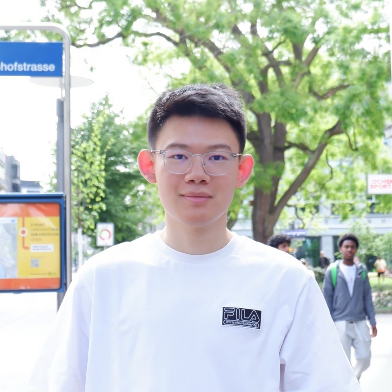

# Academic Page Story of Shizheng Wen

##

## About Me

**Tagline:** Foundation models for physics, learned from the equations themselves.

Hi, I'm Shizheng. Today's world models learn what the physical world looks like. I build models that compute how it **behaves**, from the equations that govern it and with the accuracy that **engineering** and **science** require. Physics has no internet-scale corpus to learn from, so I build the full stack: **infrastructure**, **architecture** and **training**.

- **Based at:** [Seminar for Applied Mathematics](https://math.ethz.ch/sam), [ETH Zurich](https://ethz.ch/en.html), and the [ETH AI Center](https://ai.ethz.ch/). Advised by Prof. [Siddhartha Mishra](https://de.wikipedia.org/wiki/Siddhartha_Mishra).
- **Open source:** [TensorMesh](https://www.tensor-mesh.com/), [GAOT](https://camlab-ethz.github.io/GAOT/), [torch-sla](https://www.torchsla.com/)
- **Recognition:** ETH Medal, with papers at ICML, NeurIPS and ICLR

## Selected work

Stat line: 2 NeurIPS, 1 ICML, 1 ICLR, ETH Medal.

- **TensorMesh** (Infrastructure, ICML 2026). Differentiable, GPU-native finite elements in PyTorch. It generates training data and evaluates physics losses inside the training loop. [Project](https://www.tensor-mesh.com/) · [Paper](https://arxiv.org/abs/2602.05052) · [Code](https://github.com/camlab-ethz/TensorMesh)
- **GAOT** (Architecture, NeurIPS 2025). A geometry-aware operator transformer: an efficient, accurate neural surrogate for PDEs on arbitrary domains. [Project](https://camlab-ethz.github.io/GAOT/) · [Paper](https://arxiv.org/abs/2505.18781) · [Code](https://github.com/shizheng-wen/GAOT)
- **Preconditioned PINO** (Training, arXiv 2026). Label-free training from the governing equations alone. Multigrid preconditioning lets it match supervised accuracy. [Paper](https://arxiv.org/abs/2609.36216) · [Code](https://github.com/camlab-ethz/TensorPILS)
- **PDE foundation model** (upcoming, January 2027). Where the stack comes together: one model pretrained across diverse physical systems.

<!-- In the past, I have had the honor of working with Prof. [Earl Dowell](https://mems.duke.edu/faculty/earl-dowell) at Duke University, and Prof. [Wanlin Guo](https://ifs.nuaa.edu.cn/ifs/2021/1119/c16705a279074/page.htm) and Prof. [Xianglei Liu](https://scholar.google.com/citations?hl=en&user=RxW3otEAAAAJ&view_op=list_works&sortby=pubdate) at NUAA. -->

## Links

[Email](mailto:shizheng.wen@sam.math.ethz.ch)
[Google Scholar](https://scholar.google.com/citations?user=PV4NVPgAAAAJ)
[GitHub](https://github.com/Shizheng-Wen)
[LinkedIn](https://www.linkedin.com/in/shizheng-wen-1599b0184/)
[Twitter / X](https://x.com/WenShizheng)

## News
+ Sep 2026: One paper "[Preconditioned Physics-Informed Neural Operator Training](https://arxiv.org/abs/2609.36216)" is now available on arXiv.

+ Sep 2026: One paper "[Does Transolver really need a Transformer?](https://arxiv.org/abs/2609.32525)" is now available on arXiv.

+ May 2026: We open-sourced [TensorMesh](https://www.tensor-mesh.com/)! A fast, differentiable, JIT-free, debugging-friendly finite element library for PyTorch.

+ May 2026: I received the [ETH Medal](https://math.ethz.ch/news-and-events/news/d-math-news/2026/06/2026-graduation-ceremony.html) at my master's graduation ceremony, the highest honor for students with  outstanding master's and doctoral theses.

+ May 2026: One paper "[torch-sla](https://arxiv.org/abs/2601.13994)" accepted at **ICML 2026 Workshop AI4Physics**.

+ Apr 2026: One paper "[TensorGalerkin](https://arxiv.org/abs/2602.05052)" accepted at **ICML 2026**.

+ Feb 2026: We open-sourced [torch-sla](https://www.torchsla.com/)! A memory-efficient, differentiable sparse linear equation solver library for PyTorch with multiple backends.

+ Jan 2026: One paper "[MOSIV](https://arxiv.org/abs/2603.06022)" accepted at **ICLR 2026**.

+ Sep 2025: Two papers ("[GAOT](https://arxiv.org/abs/2505.18781)" and "[RIGNO](https://arxiv.org/abs/2501.19205)") accepted at **NeurIPS 2025**.

+ May 2025: Started my Ph.D. journey at the Seminar for Applied Mathematics, ETH Zurich.

+ Apr 2024: One paper "[Phase-field simulation and machine learning of low-field magneto-elastocaloric effect in a multiferroic composite](https://www.sciencedirect.com/science/article/abs/pii/S0020740324003588)" accepted at **International Journal of Mechanical Sciences (IJMS)**.

+ Nov 2023: One paper "[Feature identification in complex fluid flows by convolutional neural networks](https://www.sciencedirect.com/science/article/pii/S2095034923000533)" accepted at **Theoretical and Applied Mechanics Letters (TAML)**.

+ Jul 2022: One paper "[A machine learning strategy for modeling and optimal design of near-field radiative heat transfer](https://pubs.aip.org/aip/apl/article-abstract/121/7/071101/2834033/A-machine-learning-strategy-for-modeling-and?redirectedFrom=fulltext)" accepted at **Applied Physics Letters (APL)**.

## Publications

Filter buttons: Featured (default) · All · Neural Operators · Differentiable Solvers · Applications.

+ Preconditioned Physics-Informed Neural Operator Training, Shizheng Wen^*, Siddhartha Mishra, Marius Zeinhofer^*, arXiv preprint, 2026. [arXiv](https://arxiv.org/abs/2609.36216) · [code](https://github.com/camlab-ethz/TensorPILS) — *Tags: Featured, Neural Operators*

+ Does Transolver really need a Transformer?, Shizheng Wen, Siddhartha Mishra, arXiv preprint, 2026. [arXiv](https://arxiv.org/abs/2609.32525) · [code](https://github.com/Shizheng-Wen/flashslice) — *Tags: Featured, Neural Operators*

+ Learning, Solving and Optimizing PDEs with TensorGalerkin: an efficient high-performance Galerkin assembly algorithm, Shizheng Wen^*, Mingyuan Chi^*, Tianwei Yu, Ben Moseley, Mike Yan Michelis, Pu Ren, Hao Sun, Siddhartha Mishra, ICML 2026. [arXiv](https://arxiv.org/abs/2602.05052)· [code](https://github.com/camlab-ethz/TensorMesh) · [project](https://www.tensor-mesh.com/) — *Tags: Featured, Differentiable Solvers*

+ torch-sla: Differentiable Sparse Linear Algebra with Adjoint Solvers and Sparse Tensor Parallelism for PyTorch, Mingyuan Chi^*, Shizheng Wen^*, ICML 2026 Workshop (AI4Physics). [arXiv](https://arxiv.org/abs/2601.13994) · [code](https://github.com/sparsexlab/torch-sla) · [project](https://www.torchsla.com/) — *Tags: Featured, Differentiable Solvers*

+ MOSIV: Multi-Object System Identification from Videos, Chunjiang Liu, Xiaoyuan Wang, Qingran Lin, Albert Xiao, Haoyu Chen, Shizheng Wen, Hao Zhang, Lu Qi, Ming-Hsuan Yang, Laszlo A. Jeni, Min Xu, Yizhou Zhao, ICLR 2026. [arXiv](https://arxiv.org/abs/2603.06022)· [code](https://huggingface.co/datasets/Hanibel/MOSIV) — *Tags: Applications*

+ Geometry Aware Operator Transformer as an Efficient and Accurate Neural Surrogate for PDEs on Arbitrary Domains, Shizheng Wen, Arsh Kumbhat, Levi Lingsch, Sepehr Mousavi, Yizhou Zhao, Praveen Chandrashekar, and Siddhartha Mishra, NeurIPS 2025. [arXiv](https://arxiv.org/abs/2505.18781) · [code](https://github.com/shizheng-wen/GAOT) · [project](https://camlab-ethz.github.io/GAOT/) — *Tags: Featured, Neural Operators*

+ RIGNO: A Graph-based framework for robust and accurate operator learning for PDEs on arbitrary domains, Sepehr Mousavi, Shizheng Wen, Levi Lingsch, Maximilian Herde, Bogdan Raonić, and Siddhartha Mishra, NeurIPS 2025. [arXiv](https://arxiv.org/abs/2501.19205) · [code](https://github.com/camlab-ethz/rigno) — *Tags: Neural Operators*

+ Phase-field simulation and machine learning of low-field magneto-elastocaloric effect in a multiferroic composite, Wei Tang, Shizheng Wen, Huilong Hou, Qihua Gong, Min Yi, and Wanlin Guo, International Journal of Mechanical Sciences, 2024. [doi](https://doi.org/10.1016/j.ijmecsci.2024.109316) — *Tags: Applications*

+ Feature Identification in Complex Fluid Flows by Convolutional Neural Networks, Shizheng Wen, Michael W. Lee, Kai M. Kruger Bastos, Ian Eldridge-Allegra, and Earl H. Dowell, Theoretical and Applied Mechanics Letters, 2023. [doi](https://doi.org/10.1016/j.taml.2023.100482) — *Tags: Applications*

+ A machine learning strategy for modeling and optimal design of near-field radiative heat transfer, Shizheng Wen, Chunzhuo Dang, and Xianglei Liu, Applied Physics Letters, 2022. [doi](https://doi.org/10.1063/5.0103363) — *Tags: Applications*

+ High-performance three-body near-field thermophotovoltaic energy conversion, Chunzhuo Dang, Xianglei Liu, Haifeng Xia, Shizheng Wen, and Qiao Xu, Journal of Quantitative Spectroscopy and Radiative Transfer, 2021. [doi](https://doi.org/10.1016/j.jqsrt.2020.107411) — *Tags: Applications*

+ Ultrahigh thermal rectification based on near-field thermal radiation between dissimilar nanoparticles, Shizheng Wen, Xianglei Liu, Sheng Cheng, Zhoubing Wang, Shenghao Zhang, and Chunzhuo Dang, Journal of Quantitative Spectroscopy and Radiative Transfer, 2019. [doi](https://doi.org/10.1016/j.jqsrt.2019.05.026) — *Tags: Applications*

## Selected Awards

+ ICML Gold Reviewer, 2026

+ ETH Medal (top 2.5%), 2026

+ National Scholarship (top 1%), 2019

+ NUAA Presidential Fellowship (top 0.1%), 2019

## Invited Talks

+ Nov 2026: Differentiable Finite Elements in PyTorch: TensorMesh and its role in operator learning, University of Freiburg, hosted by Sören Bartels.

+ Sep 2026: Differentiable Physics Simulation Engine: The infrastructure for physics foundation model, Hong Kong University of Science and Technology, hosted by Tianju Xue.

+ Jun 2026: Accelerating computational science: a paradigm shift from sparse-iterative solver to dense-parallel computing, Beihang University, hosted by Kun Wang.

+ Mar 2026: Learning, Solving and Optimizing PDEs with TensorGalerkin: an Efficient High-Performance Galerkin Assembly Algorithm, Simon Fraser University, hosted by Wuyang Chen.

+ Mar 2026: Geometry Aware Operator Transformer as an Efficient and Accurate Neural Surrogate for PDEs on Arbitrary Domains, Tsinghua University, hosted by Angelica Aviles-Rivero.

+ Dec 2025: Accelerating Computational Science: From Differentiable Solvers to Geometry Aware Operator Transformers, Stanford University, hosted by Charbel Farhat.

## Teaching

+ 2025 and 2026 Fall, 401-4656-21L AI in the Sciences and Engineering (6 ECTS), [Link](https://camlab-ethz.github.io/ai4s-course/)

+ 2026 Spring, 401-0674-00L Numerical Methods for Partial Differential Equations (10 ECTS), [Link](https://www.vvz.ethz.ch/Vorlesungsverzeichnis/lerneinheit.view?semkez=2026S&ansicht=LERNMATERIALIEN&lerneinheitId=198602&lang=en)

## Service

+ Reviewer: ICLR, NeurIPS, ICML, AAAI, IJCAI, TMLR, Nature Machine Intelligence, ACM Transactions on Graphics, Computer Methods in Applied Mechanics and Engineering
